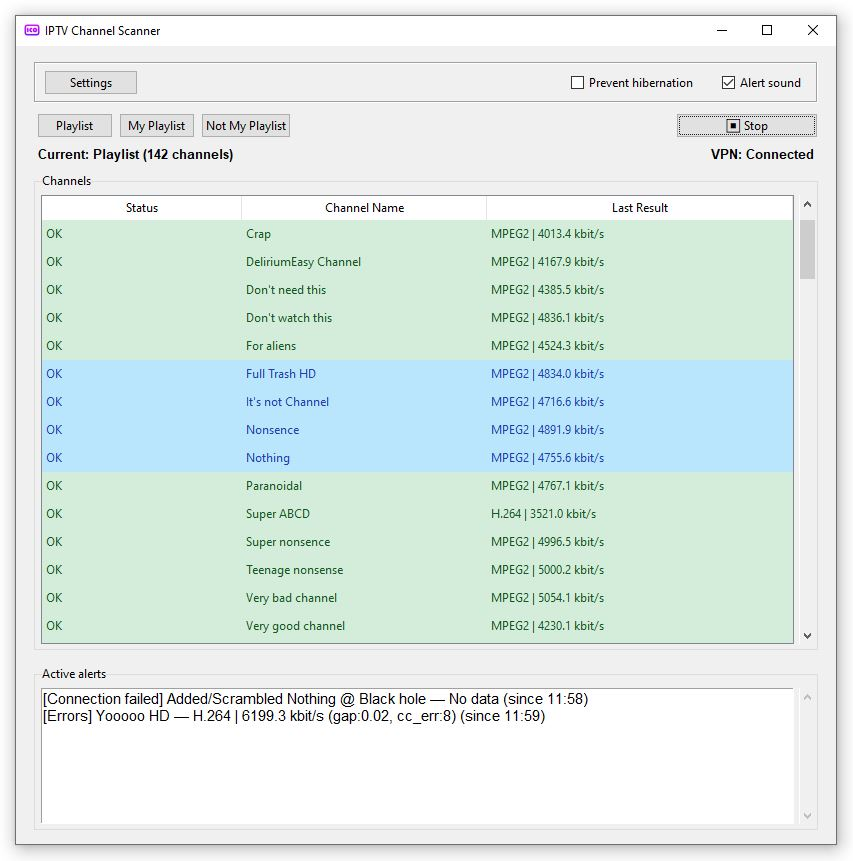
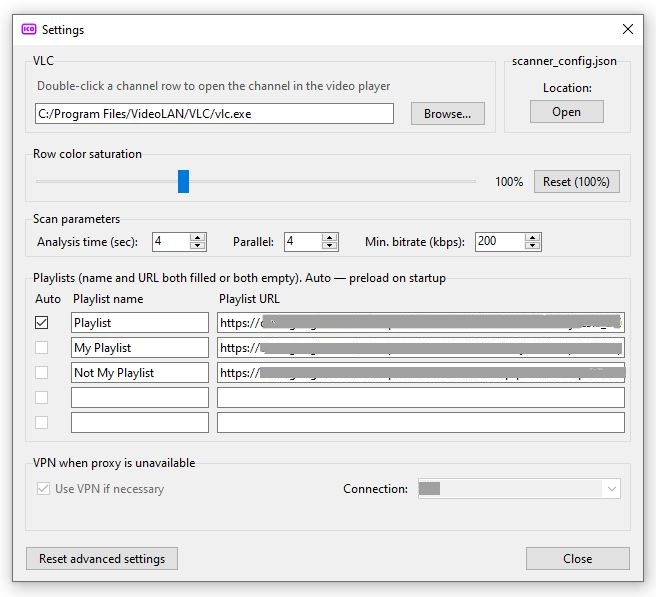

# IPTV Channel Scanner




[](https://github.com/ODVM/IPTV-scanner-and-analyser/actions/workflows/tests.yml)
[](https://github.com/ODVM/IPTV-scanner-and-analyser/actions/workflows/typecheck.yml)

A desktop tool that continuously checks the health of IPTV channels listed in M3U/M3U8 playlists.

Instead of merely testing whether a URL answers, the scanner **reads the actual MPEG-TS stream and analyzes it**: PAT/PMT tables, continuity counters, scrambling flags, codec-level start codes, bitrate, delivery gaps and more. It tells you whether a channel really has picture and sound, whether the conditional-access (CI) module has hung, or whether the encoder is just sending filler. It was built for operators who run channels through an HTTP proxy such as [udpxy](https://github.com/pcherenkov/udpxy) and want to be alerted when something breaks.

> **Platform note.** The scanner is a Tkinter GUI application designed primarily for **Windows 10/11**. The stream analysis itself is cross-platform, but the VPN fallback, network recovery, Wi-Fi reset, "prevent sleep" and sound alerts are Windows-only and are disabled elsewhere.
>
> **Language note.** The default UI language is **Russian**. Every UI string is stored in `scanner_config.json` (`ui_strings`), so the interface can be translated to any language without touching the code.

---

## Table of contents

- [Features](#features)
- [How channels are analyzed](#how-channels-are-analyzed)
- [Channel statuses](#channel-statuses)
- [Requirements](#requirements)
- [Installation and running](#installation-and-running)
- [Usage](#usage)
- [Configuration](#configuration)
- [VPN fallback](#vpn-fallback)
- [Network monitoring and self-recovery](#network-monitoring-and-self-recovery)
- [Building a standalone `.exe`](#building-a-standalone-exe)
- [Development: tests and type checking](#development-tests-and-type-checking)
- [Project structure](#project-structure)
- [Security notes](#security-notes)
- [Disclaimer](#disclaimer)
- [License](#license)

---

## Features

- **Deep MPEG-TS analysis**, not just an HTTP ping (see [below](#how-channels-are-analyzed)).
- **Detailed, actionable statuses**: healthy, radio, scrambled, hung CI module, no picture, no audio, dead, errors, connection failure and more.
- **Up to 5 playlists** (name + URL each), one of which can be preloaded automatically at startup.
- **Parallel scanning** (1-8 channels at once) with configurable analysis time and minimum bitrate.
- **Continuous scan loop** that cycles through the whole playlist; you can start from any selected channel.
- **Live alert list** with "since" timestamps, plus optional **sound alerts** (Windows).
- **Per-channel name prefixes** to suppress alerts for test channels, or to mark channels that are known to be scrambled so that they are checked with a simplified transport-level analysis.
- **Open a channel in VLC** with a double-click.
- **VPN fallback**: automatically dial a Windows VPN connection and route only the proxy hosts through it when the proxy is not reachable directly.
- **Network health monitor** with automatic recovery (route repair, DNS/ARP flush, Wi-Fi soft reset, adapter restart) and sleep/hibernation awareness.
- **Fully tunable**: detection thresholds, UI strings, row colors, column widths and color saturation are all editable in the config file.
- **Safe playlist loading**: hard limits on size, channel count and line length; URL query secrets are redacted in logs.
- **Single-instance** protection and a rotating log file.

## How channels are analyzed

For each channel the scanner opens the HTTP stream, reads a few seconds of data (3-15 s, default 4 s) and parses the transport stream:

1. **TS framing**: synchronization, resynchronization after garbage, and the garbage ratio.
2. **PSI tables**: PAT and PMT sections (with CRC-32/MPEG-2 validation) to discover the video and audio PIDs, including DVB private streams identified by descriptors (AC-3, E-AC-3, DTS) and teletext/subtitle PIDs which are correctly *not* counted as audio.
3. **Scrambling**: `transport_scrambling_control` ratios for video and audio, and PES-header analysis to detect a hung CI module that left the payload encrypted while the flags were reset.
4. **Picture presence**:
   - MPEG-2: picture / slice / sequence / GOP start codes.
   - H.264 and HEVC: VCL and parameter-set NAL units.
   - Filler detection: video that is mostly filler NALs, and MPEG-2 "black picture" streams (normalized by frame area).
5. **Audio presence**: declared vs. actually delivered audio PIDs, and AAC streams made only of fill bytes (digital silence).
6. **Transport quality**: continuity-counter errors, transport error indicator (TEI) ratio, delivery gaps between chunks, bitrate, and stuffing.

A single self-healing network hiccup (one short gap without continuity errors) is tolerated and does not flag a channel. All thresholds live in the `thresholds` section of the config (see [Configuration](#configuration)).

## Channel statuses

| Status | Meaning |
|---|---|
| `OK` | Healthy stream with picture and sound. |
| `OK*` | A channel marked as *known scrambled* (via prefix) whose transport is healthy. |
| `OK**` | Transport is healthy, but the video codec is not one the scanner can analyze. |
| `Radio` | Audio-only service. |
| `No access card` | Video is scrambled, no conditional-access decryption. |
| `CI module hung` | Scrambling flags are clear but the payload is still encrypted or garbled. |
| `No picture` | Video PID is present, but there is no decodable picture (empty, filler or black). |
| `No audio` | No audio declared in the PMT, none delivered, scrambled, or silent fill only. |
| `Dead` | Bitrate below the configured minimum or no usable data. |
| `Errors` | Continuity errors, delivery gaps, TEI or garbage above thresholds. |
| `Connect failed` | The stream could not be opened (network, timeout, no data, cooldown...). |
| `Not TS` | The response is not a supported MPEG-TS stream. |
| `Internal error` | An unexpected analyzer failure (logged with a traceback once per scan). |

Status labels are the default Russian strings shown in the UI; see `ui_strings` to rename them.

## Requirements

- **Python 3.11** (the version used in CI; 3.10+ is required for the optional `truststore`).
- **Tkinter** (bundled with the python.org installer for Windows; on Debian/Ubuntu: `sudo apt install python3-tk`).
- [`requests`](https://pypi.org/project/requests/).
- *Optional:* [`truststore`](https://pypi.org/project/truststore/), so HTTPS playlists are verified against the **system** certificate store (useful behind a corporate CA). Without it the scanner uses the `certifi` bundle that ships with `requests`.
- *Optional:* [VLC](https://www.videolan.org/) to open channels from the list.
- *For the VPN fallback:* Windows 10/11 and a configured Windows VPN connection (RAS/`rasdial`).

## Installation and running

```bash
git clone https://github.com/ODVM/IPTV-scanner-and-analyser.git
cd IPTV-scanner-and-analyser

python -m venv .venv
.venv\Scripts\activate            # Windows
# source .venv/bin/activate       # Linux/macOS

pip install -r requirements.txt   # requests, truststore
python IPTV_scanner.pyw
```

`.pyw` files run without a console window when launched via `pythonw` or by double-clicking. Use `python IPTV_scanner.pyw` if you want to see console output while debugging.

Keep `vpn.py` **in the same folder** as `IPTV_scanner.pyw`; it provides the VPN subsystem. If it is missing, the app still starts but the VPN fallback is unavailable.

## Usage

1. Open **Settings** and add at least one playlist: a **name** and an **HTTP(S) URL** to an M3U/M3U8 file (both fields must be filled or both empty). Tick **Auto** next to one playlist to preload it at startup.
2. Optionally set the path to VLC, the analysis time, the number of parallel checks and the minimum acceptable bitrate.
3. Click the playlist button to load it, then press **Start**.
4. Watch the status column and the **Active alerts** panel. Alerts appear when a channel turns unhealthy and disappear when it recovers.

Handy interactions:

| Action | Effect |
|---|---|
| Double-click a channel | Open it in VLC (known-scrambled channels show a notice instead). |
| Right-click a channel | Copy URL, name, result, or everything. |
| Select a row, then **Start** | Begin scanning from that channel. |
| `F5` | Reload the current playlist (rate-limited, also works during a scan). |
| *Alert sound* checkbox | Toggle audible alerts (Windows). |
| *Prevent hibernation* checkbox | Keep the machine awake during long scans (Windows). |

**Playlist format.** Standard M3U/M3U8: `#EXTINF` provides the channel name (the `tvg-name` attribute is understood), non-comment lines are stream URLs. Playlists must be served over HTTP(S). Limits: 10 MB per playlist, 10,000 channels, 2,048 characters per line. Typical stream URLs look like `http://proxy-host:4022/udp/239.1.1.1:1234`.

## Configuration

Settings are written to `scanner_config.json` automatically. Most of them are available in the Settings window; advanced ones can be edited by hand (close the app first).

**Where files live**

| File | Location |
|---|---|
| `scanner_config.json` | Next to the program; falls back to `%LOCALAPPDATA%\IPTV_Scanner\` if that folder is not writable (e.g. `Program Files`). |
| `scanner.log` | `%LOCALAPPDATA%\IPTV_Scanner\logs\` (rotating, ~1 MB with one backup). |
| VPN client state / helper log | `%LOCALAPPDATA%\IPTV_Scanner\` |
| `logo.ico` (optional) | Next to the program; used as the window icon. |

> The config contains your playlist URLs. **Never commit `scanner_config.json`** to a public repository; it is listed in `.gitignore`.

**Main keys**

| Key | Description |
|---|---|
| `vlc_path` | Path to the VLC executable. |
| `scan_timeout` | Analysis time per channel, 3-15 s (default 4). |
| `parallel` | Channels checked simultaneously, 1-8 (default 4). |
| `min_bitrate_kbps` | Minimum acceptable bitrate, from 100 (default 200). |
| `playlist_names`, `playlist_urls` | Up to 5 playlists. |
| `preload_playlist` | Name of the playlist to load automatically at startup. |
| `no_alert_prefixes` | Channel-name prefixes (case-insensitive) for which sound/alerts and issue logging are suppressed. Empty by default. |
| `known_scrambled_prefixes` | Channel-name prefixes of channels known to be scrambled; they get a transport-level check and `OK*`. Empty by default. |
| `thresholds` | Detection thresholds (packet counts, ratios, bitrate, gap, continuity errors, filler detection...). Invalid values fall back to defaults. |
| `ui_strings` | Every UI label and message (translate or rename here). |
| `tree_colors`, `column_widths`, `color_saturation` | Appearance. Raising the saturation compensates for the Windows 11 HDR desaturation of SDR apps. |
| `vpn` | `enabled`, `connection_name`, `all_user` (see below). |

"Reset advanced settings" in the Settings window restores thresholds, UI strings, colors, column widths and prefixes to their defaults without touching playlists, VLC, scan parameters or VPN.

## VPN fallback

Some proxies are only reachable through a VPN. When enabled, the scanner runs a **pre-check** before scanning:

1. It probes the proxy hosts found in the current playlist (TCP + HTTP).
2. If they are unreachable, it dials the selected Windows VPN connection and adds **host routes (/32) only for those proxy hosts** through the VPN adapter, so the rest of your traffic stays on the normal path. It removes the VPN default route (split tunnel) and restores the previous state on exit.
3. If the VPN drops, it reconnects with a back-off and warns you after repeated failures.

Because routing changes require administrator rights, the VPN subsystem is split in two roles that live in the same `vpn.py` file:

- **Client (normal user rights):** lists VPN connections, dials via the Windows RAS API using the credentials already stored by Windows (the scanner never sees a password), and talks to the helper.
- **Elevated helper (admin rights, launched on demand via UAC):** adds/removes routes, toggles split tunneling, flushes ARP, restarts adapters, and disconnects the VPN if the GUI dies unexpectedly. It listens on a local Windows named pipe; commands that change the network state are accepted only from the registered client process.

If you decline the UAC prompt when enabling the option, the VPN feature is switched off. IPv6 literals in channel URLs are not routed through the VPN.

## Network monitoring and self-recovery

While scanning, a background monitor watches physical connectivity and VPN health, and the scanner reacts instead of flooding you with false alerts:

- **No internet:** scanning pauses, the status shows "no internet", and it resumes when connectivity returns.
- **Sleep/hibernation:** gaps in the heartbeat are detected; after wake-up the scanner waits for the network and resumes.
- **Degraded path:** if many recent reads show continuity errors, or whole batches fail to connect, it runs a graduated recovery: flush DNS/ARP, re-apply VPN routes, and (rate-limited to once per 10 minutes) a Wi-Fi soft reset or adapter restart.
- **Hung connections:** stuck network threads are tracked and cleaned up; if recovery does not help, scanning is stopped with an explanation rather than silently degrading.
- **Failed channels** enter a short cooldown so a dead host is not hammered.

## Building a standalone `.exe`

The build is a two-step process because the scanner verifies the SHA-256 of the VPN helper executable before launching it elevated. `build.py` automates all of it:

```bash
pip install -r requirements-dev.txt     # includes PyInstaller
python build.py
```

What `build.py` does:

1. Resets `EXPECTED_VPN_HELPER_SHA256` in `vpn.py` to an empty string.
2. Builds `dist/vpn.exe` with PyInstaller.
3. Computes the SHA-256 of `vpn.exe` and writes it back into `vpn.py`.
4. Builds `dist/IPTV_Scanner.exe` (with `vpn` and `truststore` bundled), which now embeds that hash.

Distribute `IPTV_Scanner.exe` and `vpn.exe` together, in the same folder. An optional `logo.ico` next to them is used as the window icon.

<details>
<summary>Manual build (what the script does)</summary>

```bash
pyinstaller --noconfirm --clean --onefile --windowed --name vpn vpn.py
python -c "import hashlib,pathlib; print(hashlib.sha256(pathlib.Path('dist/vpn.exe').read_bytes()).hexdigest())"
# paste the lowercase hex into EXPECTED_VPN_HELPER_SHA256 in vpn.py, then:
pyinstaller --noconfirm --clean --onefile --windowed --name IPTV_Scanner ^
  --hidden-import vpn --hidden-import truststore --add-data "vpn.py;." IPTV_scanner.pyw
```

</details>

> **Note:** `build.py` modifies `vpn.py` in place, and a PyInstaller build is not byte-for-byte reproducible, so the hash changes with every build. Do not commit the hash from a local build by accident; review `git diff vpn.py` before committing.
>
> **For forks:** the hash in this repository belongs to the original author's build. A frozen build of your own will refuse to start the helper ("integrity check failed") unless `EXPECTED_VPN_HELPER_SHA256` matches **your** `vpn.exe`. `build.py` takes care of that. The check is skipped when running from source, and an empty value disables it.

## Development: tests and type checking

```bash
pip install -r requirements-dev.txt

pytest -q --timeout=60     # unit tests
mypy                       # static type checking (config in mypy.ini)
```

- Tests never open outbound connections (only `127.0.0.1`) and never execute `route.exe` or PowerShell. Windows-only code is guarded by `IS_WINDOWS`, so the cross-platform logic (TS parsing, classification, config handling, VPN helper state machine, command validation) is tested on Linux in CI.
- `mypy` is configured with `platform = win32` so that Windows-only branches (`ctypes.wintypes`, `winreg`, `winsound`) are type-checked correctly even on a Linux runner.
- GitHub Actions workflows: `.github/workflows/tests.yml` and `typecheck.yml`.

`IPTV_scanner.pyw` has a `.pyw` extension, so tests load it with `importlib` (see `conftest.py`).

## Project structure

```
.
├── IPTV_scanner.pyw        # GUI, TS analyzer, scanner, network monitor
├── vpn.py                  # VPN subsystem: client + elevated helper
├── conftest.py             # pytest fixtures and synthetic TS packet builders
├── test_iptv_scanner.py    # scanner / analyzer / GUI-logic tests
├── test_vpn.py             # VPN subsystem tests
├── build.py                # builds vpn.exe + IPTV_Scanner.exe, embeds the helper hash
├── mypy.ini                # type-check configuration
├── requirements.txt        # runtime dependencies
├── requirements-dev.txt    # tests, mypy, PyInstaller
├── LICENSE
└── .github/workflows/      # tests.yml, typecheck.yml
```

## Security notes

- TLS verification is always on for playlist and stream requests (`verify=True`). Install `truststore` if you need the Windows certificate store.
- Playlists are downloaded with strict size, channel-count and line-length limits (including after decompression) to protect against oversized or malicious files.
- Sensitive URL query parameters are redacted in logs.
- All values interpolated into PowerShell commands (VPN names, etc.) go through a strict single-quote escaper that also handles typographic quotes, and external tools are called with absolute system paths and argument lists, not through a shell.
- The elevated helper accepts only a small, validated command set, limits message and route-batch sizes, and restricts network-changing commands to the registered client process. When frozen, its executable is verified by SHA-256 before UAC elevation. Note that this protects against replacing `vpn.exe` alone; for stronger guarantees, sign your release binaries (Authenticode).

Found a vulnerability? Please open a private security advisory rather than a public issue.

## Disclaimer

This tool only **analyzes streams you are authorized to access**. It does not include, distribute or endorse any playlists or content sources. Do not publish playlists, stream URLs or credentials in issues or pull requests.

## License

Released under the [MIT License](LICENSE).
